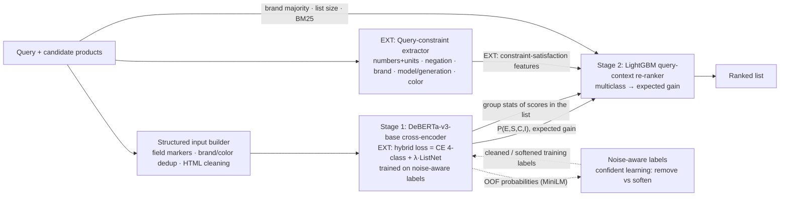

# Project Workflow – Semantic Matching and Ranking for E-commerce Product Search

IT4868 Web Mining · Dr. Duong Quang Huy · SoICT, HUST
Team: Vu Do Minh Thao · Vu Duc Duy · Trinh Binh An · Trinh Thanh Cong

This document is the team's working plan. It follows two sources:

- the **IT4868 project instruction** (academic approach, evaluation criteria);
- our **project proposal** (problem, baselines, directions, experiments, roles).

The project is run as an **experimental study**. We do not aim for one best leaderboard number. The goal is to measure *which design choices matter, by how much, and for which queries*. Every choice in the pipeline is therefore a config factor. Every factor is tested in an ablation with a stated hypothesis, a fixed protocol and a significance test.

Schedule: **5 weeks**, from Mon 2026-11-09 to the presentation in the week of 2026-12-07.

---

## 1. Overview

### 1.1 Task

| | |
|---|---|
| Problem | KDD Cup 2022 ESCI Challenge, **Task 1: query–product ranking** |
| Input | a query `q` and its candidate products `C_q` (given, about 20 per query, median 16) |
| Output | a ranking of `C_q` |
| Labels | E (Exact), S (Substitute), C (Complement), I (Irrelevant) |
| Objective | maximize **nDCG** with the official gains `g(E)=1, g(S)=0.1, g(C)=0.01, g(I)=0` |
| Scope | Task 1 only, English (`product_locale == "us"`), reduced version (`small_version == 1`); no retrieval over the full catalog |
| Data | Shopping Queries Dataset (Apache-2.0), from `github.com/amazon-science/esci-data`: examples + products parquet, joined on `product_locale` + `product_id` |

**Formal definition (instruction Step 1).**
- **Input:** a query `q`, a short free-text string, and its candidate list `C_q = {p_1, …, p_n}`, where n is typically 16 or 40.
- Each product `p` has text fields: `title`, `brand`, `color`, `bullet_point`, `description`. Any of them may be empty; 48% of products have no description.
- **Model:** a scoring function `f(q, p) → ℝ`.
- **Output:** the permutation of `C_q` sorted by `f` in decreasing order.
- **Evaluation:** nDCG of that permutation against the gold labels `y ∈ {E, S, C, I}`, using gains `g(y)`.

**Example (from the proposal).** Query: *"ipad case 8th generation without front cover"*. Almost every candidate is an iPad case sharing these words.
- A transparent back case is **Exact**.
- Folio cases *with* a front cover are **Substitutes**.
- A case for an older iPad is **Irrelevant**.

A good ranking needs to understand the negation and the model number, not only word overlap.

**Challenges.**
1. **Short, specification-heavy queries:** numbers, units, brands, negations (`64gb`, `without front cover`).
2. **Vocabulary mismatch** between what users type and how products are described.
3. **Graded, not binary, relevance.** E and S make up about 80% of pairs and often differ in a single attribute, so separating E from S is the core difficulty.
4. **Missing fields and noisy labels:** near-identical products in the same list sometimes get different labels.
5. **Hard queries only:** the reduced version removed "easy" queries, so trivial rankings score poorly.
6. **Compute budget:** large cross-encoders are expensive on free Colab/Kaggle GPUs.

### 1.2 Baselines

- B1: BM25 on product text.
- B2: pre-trained bi-encoder, zero-shot.
- B3: reproduction of Amazon's cross-encoder (`ms-marco-MiniLM-L-12-v2`, title only, MSE on gains).

The baselines represent three **families of methods**: B1 is lexical matching, B2 is zero-shot dense matching without query–product interaction, B3 is a joint encoder fine-tuned on ESCI that sees the title only. They differ at the same time in input fields, pre-training and supervision, so comparing them ranks the families on this data. It does not isolate the causal effect of a single capability (for example "token interaction"). The method cards in §1.4 give the details.

### 1.3 Final proposed system

The proposed system builds on the strongest ideas of the published ESCI solutions and adds three extensions of our own (marked **EXT**). Each EXT component has its own ablation (§4.2), so the report can show what it adds on top of the inherited parts.

**How we position the EXT components.** We do not claim methodological novelty. A hybrid pointwise + listwise loss and rule-based match features are known ideas in learning to rank. Our claim is narrower: *among the ESCI papers we reviewed (§4.4), none reports these variants on Task 1*, so we test them under one controlled protocol. The report separates three kinds of contribution: (a) empirical findings from controlled ablations, (b) engineering choices made to fit the compute budget, and (c) applying known techniques to this task. If we keep any stronger claim, the literature review must be extended first.

**Main research question.** *Which signals improve E-vs-S discrimination on top of a fine-tuned cross-encoder, and for which query types?* The candidate signals are input fields, the training objective, explicit constraint features and list context. Candidate **primary hypotheses** are written down in W1. One is chosen at Gate G2 (§6), using only query counts and the MDE, never an observed Δ. Each candidate must state:
- the comparison (variant vs reference) and the population: all queries, or a detector-flagged subgroup (§1.3 EXT 2);
- **one primary metric**. *E-before-S accuracy* (§3.4) for a claim about E-vs-S discrimination; *nDCG* for a claim about the overall ranking. The other metric is secondary;
- the target effect size, α = 0.05 (two-sided), and the power check of §3.5.

A subgroup can be the primary population if it is large enough. "Large enough" is not a fixed percentage. It means that, with the actual number of Test queries in the subgroup, the minimum detectable effect (§3.5) is no larger than the target effect. EDA in W1 counts the queries with each constraint type. The MDE estimate in W2 then decides whether a constraint-based hypothesis can be primary. All other comparisons are secondary or exploratory and are labelled as such in the report.

**Dependencies of the primary hypothesis are Must.** Every component the primary hypothesis needs moves to *Must* in the priority table (§6), whatever its default tier. Constraint features as primary → LightGBM Stage 2, MiniLM OOF and the extractor audit become Must. Noise handling as primary → OOF probabilities and the label-issue audit become Must. Hybrid loss as primary → the group sampler and the calibration check become Must.



**What is inherited and what is new**

| Component | Inherited from | Our change |
|---|---|---|
| Structured input: `query [SEP] title · brand: … · color: … · bullets` | 1st place (field markers, many fields); 2nd place (merge brand/color only if missing from the title, HTML removal) | Combines both. Each field is ablated on English data, which neither paper reports. |
| DeBERTa-v3 cross-encoder | 1st and 2nd place (both use the large size) | Base size, to fit a student compute budget |
| 4-class classification → expected gain `s = P(E) + 0.1·P(S) + 0.01·P(C)` | 1st place; "Some Practice" | **EXT – hybrid loss** (see below) |
| Confident learning on OOF predictions | ZhichunRoad (+0.005 nDCG on Task 1) | **EXT – removal vs soft relabelling compared.** Soft relabelling is 1st place's self-distillation, `y = 0.7·hard + 0.3·OOF soft`. Both reuse the OOF predictions of Stage 1. |
| LightGBM stage 2: group stats, brand majority, list size, multiclass + expected gain | "Some Practice"; brand idea from 2nd place | **EXT – constraint-satisfaction features**; dataset-artifact features excluded on purpose (§3.3) |
| Out-of-fold stacking | "Some Practice" (2 folds) | None (protocol choice): 5-fold OOF for MiniLM, 2-fold OOF for DeBERTa to fit the budget (see "OOF for the expensive backbone" below) |

**EXT 1 – Hybrid loss (pointwise + listwise).**
- The loss is `L = CE(p_i, y_i) + λ · ListNet(q)`.
  - The ListNet term is a cross-entropy between `softmax(g_i / τ)`, where `g_i` is the gain of the true label, and `softmax(s_i / τ)` over the candidates of the same query.
  - `s_i` is the model's expected gain, so `s_i ∈ [0, 1]`.
- **Temperature τ matters as much as λ.** The gains are `1, 0.1, 0.01, 0`. With τ = 1 the target weights are `e^1 = 2.72` for E, `e^0.1 = 1.11` for S, `1.01` for C and `1.00` for I. The target then barely separates S from I. For a list of 1 E and 19 I, the E target is only `2.72 / (2.72 + 19) ≈ 0.125`. With τ = 0.1 the S-vs-I ratio becomes `e^1 ≈ 2.7`, but E then takes almost all the target mass whenever the list has an Exact, which may weaken the signal among the other classes. Neither value is assumed better; this is an empirical question. A3 runs the **full 2×2 grid** τ ∈ {0.1, 1} × λ ∈ {0.5, 1} (4 MiniLM runs). The gradient of the ListNet term scales with 1/τ, so τ and λ are not independent. Each cell is screened with one seed, so the grid is reported as a **descriptive sensitivity table**. We do not claim a measured interaction effect. Only the best cell goes on to the 3-seed confirmation.
- **Reduction (fixed).** CE is averaged over the pairs of a query, then over the queries of the batch. ListNet is computed once per query and averaged over queries. Both terms are thus weighted per query, independent of list length.
- **Soft labels.** When EXT 3 soft labels are used, CE uses the soft target vector and the ListNet target uses the *expected gain* of the soft label, `g_i = Σ_c y_i,c · g(c)`.
- **Removed pairs.** When EXT 3 removes pairs, the ListNet softmax runs over the remaining candidates of the query. A query left with fewer than 2 candidates, or with all remaining gains equal, contributes only to the CE term.
- Expected roles of each term (hypotheses, checked in A3):
  - The CE term should give usable class probabilities for Stage 2, confident learning and expected-gain ranking. CE training alone does not guarantee calibration, and the ListNet term may make it worse. We therefore measure NLL, Brier score and ECE (§3.4) for the A3 variants with a **4-class head trained with a CE term** (CE4 and hybrid). For MSE (scalar output) and ListNet-only (the loss constrains only the expected gain, so the class distribution is not identified), calibration is reported as **N/A**. We do not convert a scalar score into 4-class probabilities.
  - The ListNet term trains the model on the ordering inside each candidate list, which is what nDCG measures.
- Why we test it: among the solutions we reviewed, the 1st place used CE only and the 2nd place used MSE only (they found pairwise worse). None reported a listwise term.
- Implementation: batches are built from whole queries (a group sampler). **A list is never split across micro-batches**: a softmax over part of a list is not ListNet over the whole list, and gradient accumulation does not fix that. One micro-batch holds one or more complete queries. If the longest list does not fit, we first reduce to **one query per micro-batch**, then turn on **gradient checkpointing**. We never change the input to make a list fit.
- **Truncation policy (fixed before A2, shared by all variants of a comparison).** `max_len` is a config value. When a sequence is too long, the bullets are cut first, then the description, never the query or the title. Each run logs the share of pairs that were truncated. A different `max_len` is a different configuration and is labelled as such.
- `losses.py` is unit-tested on small lists whose loss and gradient are computed by hand.
- **Same sampler for all A3 variants.** MSE, CE, ListNet and hybrid are all trained with the group sampler, so A3 compares losses, not batch composition.

**EXT 2 – Query-constraint extractor and constraint-satisfaction features.**
- The main error is E vs S, which "often differ in a single attribute" (proposal §3).
- A rule-based extractor reads the query's explicit constraints and checks each against the product's title, bullets, brand and color. Each check returns *match / conflict / absent*:
  - numbers with units (`64gb`, `10 inch`, `2 pack`, `8th generation`), with unit normalization;
  - negation (`without front cover`, `no …`, `… free`). The negated term appearing in the product is **not** enough for *conflict*. The rule returns *conflict* only if the term appears **without** a negation cue in a short window before it (`no`, `without`, `-free`, `not include`). A term that appears negated (`no front cover`) returns *match*. Everything else returns *unknown*. This rule is still a heuristic; its precision is measured on the audit set;
  - brand mentioned in the query vs product brand;
  - model / generation tokens (`a2270`, `iphone 12`);
  - color words vs `product_color`.
- The outputs become one feature group in Stage 2.
- The same module also produces the query-type tags for the error analysis. Two kinds of output are kept apart:
  - **Query-side tags** (does the query contain a negation cue, a number with a unit, a brand, a model token?) depend on the query text only. They define the E5 subgroups.
  - **Pair-level checks** (match / conflict / absent) are the Stage-2 features. They are less reliable. For example, `without front cover` vs a product saying `no front cover` contains the string "front cover" but is not a violation. A brand in a title may be the brand of the compatible device, not the maker. One product may list several sizes or models. And an attribute that is *absent* is not a *conflict*.
  - Subgroups are reported as "queries **flagged by the detector**", not as all queries with that linguistic property.
- **Audit set (W2, before any Stage-2 result is seen).** We sample about 150 (query, product) pairs, stratified by constraint type plus some untagged queries. One member who did not write the rules labels the query constraints and each check as match / conflict / unknown. A second member re-labels about 50 of them to estimate agreement. We report the coverage of the query tags and the precision/recall of the pair checks. This separates "the rule helps" from "the rule is wrong".
- Optional variant: write the check results into the cross-encoder input as short text hints (one MiniLM run in A2).

**EXT 3 – Noise-aware labels: remove vs soften.**
- Confident learning (cleanlab) flags training pairs whose OOF probabilities strongly disagree with the given label.
- We compare three ways to handle them: keep all labels, remove the flagged pairs (ZhichunRoad), or replace them with soft labels (1st place's self-distillation).
- The two published papers each used one option. We compare them under the same protocol.
- Flagged pairs are called **suspected label issues**. The OOF model disagreeing with the annotator does not prove the annotator wrong, and E/S is exactly the hard boundary where pruning may remove the most useful examples.
- Checks added to A5:
  - **Random-removal control:** remove the same number of randomly chosen pairs, stratified by class, to separate "removing noisy pairs" from "removing pairs / changing the class balance".
  - Statistics of what is flagged: per class, per query type, number of queries affected.
  - Manual audit of about 50 flagged and 50 non-flagged pairs, sampled before the A5 results are seen.
- **Leakage when labels are reused.** The flag or soft label of a pair in fold j comes from a model that was trained on the other folds, including fold k. If a fold-k-excluded model is then trained on these cleaned labels and predicts fold k, information from fold k's labels leaks into its OOF scores. The same holds for the DeBERTa 2-fold OOF: its cleaned labels come from MiniLM models that saw the other DeBERTa fold. The leak is mild for removal (a binary keep/drop decision) and more direct for soft labels.
  - **What it affects.** V and Test labels are never used to build flags or soft labels, so V and Test evaluation stays clean. The leak only makes the **T OOF scores** slightly optimistic compared with V/Test scores, so Stage 2 may over-trust the Stage-1 score. It is a train/test mismatch for Stage 2, not contamination of the evaluation.
  - **Default (planned).** A6 (Stage-2 ablations) uses the OOF predictions of the **uncleaned** MiniLM model, so no leak there. For the final DeBERTa pipeline with noise-aware labels, we accept the mild leak, prefer removal over soft labels if both are equally good on V, and state the limitation in the report.
  - **Not planned.** Recomputing flags inside each outer fold (nested cleaning) would remove the leak but multiplies the GPU cost. It is listed as future work.
- **Transfer risk.** Flags come from MiniLM OOF predictions. They reflect MiniLM's errors, and DeBERTa may learn some of those hard pairs correctly. A5 runs on MiniLM only, so the "+noise-aware labels" row of A7 on DeBERTa is the first real test of transfer. It is reported as such.

**OOF for the expensive backbone (protocol choice, not an extension).**
- Stage 2 must be trained on Stage-1 scores the Stage-1 model did not see during training. For MiniLM we get them by 5-fold OOF stacking on T.
- For DeBERTa we use **2-fold OOF on T**, as "Some Practice" did. Each fold model trains on half of T, so the total cost is about **one** full training run.
- **No averaging before Stage 2.** On T, each row's Stage-1 features come from a single half-T model. To keep V/Test features from the same kind of model, we do **not** average the two fold models' scores before Stage 2. Instead, Stage-2 features (including the within-list group statistics) are built separately from fold model A and from fold model B. LightGBM scores both, and **the two Stage-2 expected gains are averaged**. This costs CPU only.
- For rows without Stage 2 (Stage-1-only rows of A7), the V/Test score is the average of the two fold models' expected gains, called the **"DeBERTa 2-fold ensemble"**.
- Why not train LightGBM on V instead ("V-blending")? V already selects every configuration, so training Stage 2 on V gives it two roles. It also trains Stage 2 on about 2k queries instead of about 19k, and it cannot be evaluated on V like the OOF scheme. 2-fold OOF has about the same cost and none of these problems.
- The price: each fold model sees only 50% of T, so its scores may be slightly weaker than a full-T model. A full-T model and the 2-fold ensemble differ in both training size and ensembling, so they are never mixed within one comparison (§4.2 A7). If both exist, "full-T vs 2-fold ensemble" is reported as a separate comparison on V.

**Mapping to the proposal**
- D1 = structured input + DeBERTa.
- D2 = the objective comparison, extended with the hybrid loss.
- D3 = the LightGBM re-ranker, with the proposal's match features (numbers, units, negation) extended into the constraint extractor.
- Confident learning moves from the proposal's "if time allows" list into the plan as an EXT component. It is the only technique with a published **Task 1** gain, and it reuses OOF predictions we already compute. Its tier follows the priority table (§6): *Stretch* by default, *Must* if it is the primary hypothesis.
- Still optional: label smoothing, RankNet and ordinal objectives, a larger backbone, a small ensemble.

### 1.4 Method cards (instruction Step 2)

Each card answers the instruction's questions:
- why the method was chosen;
- its input representation;
- how it is trained;
- how it predicts (output).

The expected strengths and weaknesses are hypotheses. The error analysis (E5) checks them per query type, and the report's strengths/weaknesses chapter (Step 5) is written from those results.

#### B1 – BM25 (lexical baseline)
| | |
|---|---|
| Why chosen | The classic IR ranking function from the course. It has a published ESCI reference (0.675) and shows how far pure word overlap gets. |
| Input representation | The query and a product document (`title + brand + color + bullets`) are lowercased and tokenized into bags of words. IDF is computed over all `us` products of the reduced set. |
| Training | None. Uses `k1 = 1.5`, `b = 0.75`, optionally tuned on V. |
| Prediction (output) | `BM25(q, p)` for every candidate → sort in decreasing order. |
| Expected strengths | No training; exact matches on brands and model numbers; fast and interpretable. |
| Expected weaknesses | Vocabulary mismatch. Ignores negation (`without cover` *rewards* products containing "cover"). No notion of graded relevance. |

#### B2 – Bi-encoder, zero-shot (dense baseline)
| | |
|---|---|
| Why chosen | Tests whether pre-trained semantic embeddings fix vocabulary mismatch without any ESCI training. This is the standard dense-retrieval approach from the course. |
| Input representation | The query and the product text (`title + brand + color`) are encoded **separately** into one vector each by a search-oriented sentence-transformers model (default `multi-qa-mpnet-base-dot-v1`). |
| Training | None (zero-shot). |
| Prediction (output) | Similarity (dot product / cosine) between the query and product vectors → sort. |
| Expected strengths | Handles synonyms and paraphrases. Product vectors can be precomputed. |
| Expected weaknesses | Query and product tokens never interact, so it is weak on fine attribute differences (E vs S), numbers and negation. Not adapted to ESCI's notion of relevance. |

#### B3 – Amazon's cross-encoder (official baseline, reproduced)
| | |
|---|---|
| Why chosen | The official baseline (0.857 published). It is the reference point for every Stage-1 ablation. |
| Two versions | **B3-repro** runs Amazon's protocol as is, to compare with the published number. **B3-ctrl** uses our protocol (T/V split, our `max_len`, group sampler, our metric) and is the reference for A2. Only B3-ctrl is compared with our variants. |
| Input representation | One joint sequence `[CLS] query [SEP] product_title [SEP]`, read by `cross-encoder/ms-marco-MiniLM-L-12-v2` (pre-trained on MS MARCO passage ranking). We start from this public MS MARCO checkpoint. We do **not** use any model already fine-tuned on ESCI: it would have seen V's queries. |
| Training (B3-repro) | Amazon's `ranking/train.py`, pinned at commit `7916cdf` (latest on `main` when checked; re-check in W1). `CrossEncoder(num_labels=1, max_length=512, default_activation_function=Identity)`, `MSELoss` between the **raw logit** (no sigmoid) and the gain `E=1, S=0.1, C=0.01, I=0`. One epoch, lr 7e-6, batch 32, warm-up 5,000 steps, dev = 200 held-out queries (`--n_dev_queries`), split seed 42. |
| Training (B3-ctrl) | Same loss, lr and epoch count, trained on T, `max_len` by the truncation policy (§1.3 EXT 1), batches from the group sampler. With whole-query batches the number of pairs per step varies, so the schedule is defined by pairs, not copied as "5,000 steps": the target batch is about 32 pairs (whole queries added until the batch reaches 32 pairs; the effective batch size is logged), and warm-up covers the same **share of training** as in Amazon's run, i.e. `5,000 × 32 / #train pairs` of the total pairs, converted into our optimizer steps. Every difference from B3-repro is listed in the report. |
| Prediction (output) | One relevance score per pair → sort. |
| Expected strengths | Full token-level interaction between query and title through attention. Small and cheap. |
| Expected weaknesses | Sees the title only, so it misses attributes in brand, color and bullets. A pointwise loss scores each pair in isolation. Small capacity. |

#### Stage 1 – Structured-input DeBERTa-v3 cross-encoder (D1 + D2 + EXT 1, EXT 3)
| | |
|---|---|
| Why chosen | Every top ESCI solution uses DeBERTa-v3. Its disentangled attention and ELECTRA-style pre-training are strong at fine-grained language understanding. The extra fields hold the attributes that decide E vs S. The base size fits the compute budget. |
| Input representation | `[CLS] query [SEP] title · brand: … · color: … · bullets [SEP]`. Brand and color are added only if missing from the title, HTML is removed, and when the sequence is too long the bullets are truncated first (`max_len` 128 or 256, chosen in A2). |
| Model | DeBERTa-v3-base encoder + a 4-way classification head on `[CLS]` → `P(E), P(S), P(C), P(I)`. |
| Training | Best objective of A3 (hybrid `CE + λ·ListNet` if it wins, §1.3) on batches made of whole queries. AdamW, linear warm-up, fp16, 1–2 epochs. Training labels are noise-aware (EXT 3) only if A5 supports it. Variants compared in A3: MSE regression on gains (single scalar output), CE only, ListNet only (4-class head, loss on the expected gain), hybrid. |
| Prediction (output) | Expected gain `s = P(E) + 0.1·P(S) + 0.01·P(C)` → sort. For a fixed set of positions, sorting by expected gain maximizes expected DCG, which is why we score this way instead of using `argmax` of the class. The 4 probabilities are also passed to Stage 2. |
| Expected strengths | Reads every attribute field. Class probabilities usable by Stage 2 (calibration measured, not assumed). Training sees the whole list through the ListNet term. |
| Expected weaknesses | Costly to train. At prediction time each pair is still scored independently. Known weakness of transformers with numbers and negation, which motivates EXT 2. |

#### Noise-aware labels – confident learning (EXT 3)
| | |
|---|---|
| Why chosen | Labels are noisy (proposal §3). Confident learning is the only technique with a published Task 1 gain (ZhichunRoad, +0.005). |
| Input representation | For each training pair: the given label and the **out-of-fold** probabilities `P(E,S,C,I)` from MiniLM (§3.3). |
| Training | No model of its own. `cleanlab` estimates per-class confidence thresholds and flags pairs where another class is confidently predicted over the given label. |
| Prediction (output) | The set of flagged pairs (*suspected label issues*). They are **removed** from training, or **relabelled** with `0.7·hard + 0.3·OOF` soft labels. A random-removal control of the same size is run alongside. |
| Expected strengths | Removes contradictory supervision, mostly among near-identical products in the same list. |
| Expected weaknesses | May also remove hard-but-correct pairs, mostly at the E/S boundary. ZhichunRoad saw a *drop* on Task 2/3 for this reason. Flags come from MiniLM and may not transfer to DeBERTa. |

#### Query-constraint extractor (EXT 2)
| | |
|---|---|
| Why chosen | E and S often differ in one explicit attribute, and transformers are weak with numbers and negation. Explicit rules are precise and interpretable, and they also give the query-type tags for the error analysis. |
| Input representation | The query string; the product's title, bullets, brand and color. |
| Training | None. Regular expressions plus small lexicons: units and their normal forms, negation cues, color words, and the brand list from the product table. |
| Prediction (output) | Per (q, p) pair, for each constraint type (numbers+units, negation, brand, model/generation, color): *match / conflict / absent* indicators and counts, plus a `negation_violated` flag. These become a feature group for Stage 2. |
| Expected strengths | High precision on the attributes that decide E vs S (measured on the audit set, §1.3 EXT 2). Fully interpretable. |
| Expected weaknesses | Limited coverage (only the patterns we write); false matches on ambiguous tokens; "absent" is not "conflict". |

#### Stage 2 – LightGBM query-context re-ranker (D3 + EXT 2)
| | |
|---|---|
| Why chosen | Stage 1 scores each pair alone, but list context may help predict the label. *Hypotheses to check in W1 EDA, not assumed:* most lists contain at least one Exact; the most frequent brand in a list tends to be Exact ("Some Practice"). List context helping prediction does not mean the definition of relevance depends on the list. Task 1 gives the candidate list as input, so using it is legitimate, but conclusions are limited to re-ranking these given lists. Gradient boosting handles mixed tabular features, trains in minutes on CPU (so we can run many ablations) and gives feature importances. |
| Input representation | One row per (q, p) with six feature groups: (1) Stage-1 probabilities and expected gain; (2) group statistics of the Stage-1 score within the list (min / median / max, rank, z-score, gap to the top); (3) list size; (4) brand features (is the most frequent brand in the list, number of brands); (5) BM25 score; (6) constraint-satisfaction features. |
| Training | Multiclass objective on the 4 labels, early-stopped on V. Training data comes from OOF stacking on T: 5-fold for MiniLM, 2-fold for DeBERTa (§1.3). Alternative compared in A6: lambdarank with `label_gain = [0, 0.01, 0.1, 1]`. |
| Prediction (output) | Expected gain from LightGBM's class probabilities → sort = **final ranking**. |
| Expected strengths | Uses list context and explicit constraints; cheap; interpretable. |
| Expected weaknesses | Needs the OOF protocol to avoid leakage. List-context features may partly exploit how candidate lists were built. We do **not** claim they generalize to lists built another way. A robustness test (keep the query–product pairs, replace part of the distractor candidates, measure how the relative order of the kept products changes) is *exploratory* and only run if time allows (Stretch). Adds pipeline complexity. Gains over a strong cross-encoder may be small, so we rely on CIs and per-type analysis (§3.5). |

### 1.5 Mapping to the course instruction

| Instruction step | Where it is covered | Report chapter |
|---|---|---|
| Step 1 – well-defined problem (input, output) | §1.1 (formal definition, example, challenges) | Ch. 1 |
| Step 2 – methods, motivation, input representation / training / prediction | §1.2, §1.3, **§1.4 method cards** | Ch. 4 |
| Step 3 – benchmark dataset, available | §1.1, §3 | Ch. 3 |
| Step 4 – implementation: language, libs, modification of existing code | §2 (tools, reused vs own code) | Ch. 5 |
| Step 5 – metrics and why, comparison to baselines, strong/weak points | §3.4 (metrics and why), §4 (baselines and ablations), §1.4 (expected strengths and weaknesses, checked in E5) | Ch. 6–7 |
| Report in LaTeX (Overleaf), ≤ ~30 pages | §8 | — |
| Code on GitHub + Google Colab | §2, §7 | — |
| Strictly follow the schedule | §6 (weekly gates) | — |
| Teamwork | §6, §7, §8 (owners per task and chapter) | Ch. 8 |
| Advanced knowledge (deep learning) | Transformer cross-encoders, DeBERTa-v3, hybrid pointwise + listwise loss, confident learning / self-distillation | Ch. 4 |

---

## 2. Repository layout: built for running ablations

The code is organized so that **an ablation is a config file, not new code**. Each run is identified by its config and its seed. Each run writes everything needed to rebuild the report tables.

```
web-mining-project/
├── configs/
│   ├── base.yaml              # reference settings shared by all runs
│   ├── reference/             # the reference config of each stage (B3, best CE, ...)
│   └── ablations/             # one file per ablation family: list of variants = diffs from the reference
│       ├── A2_input.yaml
│       ├── A3_objective.yaml
│       ├── A4_backbone.yaml
│       ├── A5_noise.yaml
│       └── A6_reranker.yaml
├── data/                      # gitignored: raw/ and processed/ (splits, folds, query-type tags)
├── src/esci/
│   ├── data.py                # load, filter, join, val split, OOF folds
│   ├── text.py                # input builder (fields, markers, brand/color dedup, HTML cleaning, max_len, optional hints)
│   ├── constraints.py         # query-constraint extractor + match/conflict checks (D3 features and query-type tags)
│   ├── metrics.py             # all metrics of §3.4, per-query output
│   ├── stats.py               # paired bootstrap CI, paired t-test / Wilcoxon, Holm correction
│   ├── baselines/bm25.py, baselines/biencoder.py
│   ├── models/cross_encoder.py
│   ├── models/losses.py       # mse_gain, ce4_expected_gain, listnet, hybrid (ce4 + λ·listnet), (opt) ranknet, ordinal
│   ├── models/group_sampler.py  # batches made of whole queries (needed by listnet / hybrid)
│   ├── noise.py               # confident learning (cleanlab) on OOF probabilities: remove or soft-relabel; label smoothing
│   ├── features.py            # feature groups for D3 (§4.2 A6)
│   ├── rerank.py              # LightGBM: lambdarank or multiclass + expected gain; OOF stacking (5-fold MiniLM, 2-fold DeBERTa)
│   ├── run.py                 # python -m esci.run --config <yaml> --seed <s>
│   ├── ablate.py              # python -m esci.ablate --family A2_input --seeds 0 1 2
│   ├── tables.py              # results/runs → ablation tables (CSV + LaTeX) for the report
│   └── analysis/query_types.py, analysis/error_analysis.py
├── notebooks/                 # thin Colab/Kaggle launchers: clone repo, mount Drive, call run/ablate
├── results/
│   ├── runs/<run_id>/         # config.yaml, metrics.json, per_query_val.csv, per_query_test.csv, run_info.json
│   └── results_table.csv      # one row per run (all factor values + metrics); single source for the report
├── demo/                      # query → BM25 / cross-encoder / re-ranker lists with gold labels
├── report/                    # link to Overleaf, generated tables and figures
├── requirements.txt
└── README.md
```

**Run contract.** `esci.run` takes a config and a seed and does the following:
1. Trains (or loads) the model.
2. Predicts V (and Test only when `eval_test: true`).
3. Writes the per-query metrics.
4. Appends one row to `results_table.csv` with: run_id, family, variant, every factor value, seed, git commit, GPU type, train time, and the metrics.

Prediction files (one score per query–product pair) go to the shared Drive / Kaggle Dataset. They are reused by D3 and by the error analysis, so **no ablation ever needs to re-run a model only to get its scores**.

**Language and libraries (instruction Step 4).**
- Python 3.10+.
- Data: pandas, pyarrow.
- Lexical baseline: rank_bm25.
- Neural models: PyTorch, HuggingFace Transformers, sentence-transformers.
- Label noise: cleanlab.
- Stage 2: LightGBM.
- Splits and statistics: scikit-learn, scipy.
- Compute and code: Google Colab / Kaggle GPUs; GitHub.

**Reused vs own work.** Amazon's `esci-data` baseline code (pinned commit, §1.4 B3) is reused for B3, starting from the public `ms-marco-MiniLM-L-12-v2` checkpoint, not from any ESCI-fine-tuned model. The evaluation and statistics modules, input builder, objectives, noise handling, features, re-ranker and the ablation framework are our own work. The report lists every change to Amazon's code.

---

## 3. Experimental protocol

These rules are fixed in Week 1 and not changed afterwards.

### 3.1 Data
1. Filter `small_version == 1`, `product_locale == "us"`, then join products.
2. Expected sizes (proposal Table 1). Train: 20,888 queries / 419,653 pairs. Test: 8,956 queries / 181,701 pairs. If our counts differ, stop and check the filters.
3. Missing fields become empty strings. HTML in descriptions and bullets is removed (removal can be switched off as a factor).
4. W1 EDA also checks the assumptions used later: the share of lists with at least one Exact; how often the most frequent brand is Exact; the share of queries flagged with each constraint type; and product and near-duplicate query overlap between train and test. Product overlap is not leakage, but it limits any claim about unseen products.

### 3.2 Splits
- **Test:** official test split. It is used **only** for the comparisons on the pre-registered list (§3.6), which is frozen at Gate G3 before any test prediction is scored. **One declared exception:** B3-repro (and the B1/B2 rows that are compared with published numbers) is scored on Test in W2. B3-repro is never a candidate in any ablation, so its Test score cannot steer a model choice. It is used only to check the data pipeline and the metric. If it reveals a bug, the fix is a pipeline fix and is logged. No variant, hyper-parameter or feature is chosen using any Test score, and the report states this exception.
- **Validation (V):** 10% of training queries, split by query (`GroupShuffleSplit`, seed 42). V has **one role only**: choosing configurations and early stopping. No model is trained on V. Because every configuration is chosen on V, V results are *screening* results and may be optimistic. Confirmation comes from Test.
- **T:** the remaining training queries.
- **OOF folds:** `GroupKFold` by query on T, K = 5 (MiniLM) and K = 2 (DeBERTa). Fold ids are saved once and shared.

### 3.3 No-leakage scheme for OOF-based steps (D3 and confident learning)
1. **OOF scores:** for each fold k, train the cross-encoder on T without fold k and predict fold k. This gives OOF scores and probabilities for all of T.
2. **V and Test scores:** MiniLM: train the same configuration on all of T and predict V and Test. OOF scores come from models trained on 80% of T, V/Test scores from a model trained on 100% of T. This is a small distribution shift, not leakage. We measure it by comparing the score distributions (mean, std, per-class means) of OOF vs V, and report it. DeBERTa (2-fold): per-fold Stage 2, then average (§1.3), so there is no shift from averaging.
3. **LightGBM:** train on T (OOF features), tune and early-stop on V, evaluate on Test only for the pre-registered comparisons.
4. **Confident learning:** flag suspected label issues in T using only OOF probabilities. Retrain on the cleaned (or soft-relabelled) T. V and Test labels are never modified. A6 uses the OOF scores of the uncleaned model. The mild leak when cleaned labels feed later OOF models, and why it does not touch V/Test evaluation, is described in §1.3 EXT 3.

**Excluded features.** We do not use features that exploit dataset construction artifacts rather than relevance. Examples: position of `product_id` in the product catalog, whether a product also appears in the Task 1 subset, ISBN-style product ids. "Some Practice" reports gains from such features. We state in the report that we exclude them on purpose.

### 3.4 Metrics

| Metric | Why |
|---|---|
| **nDCG over the full list, official gains** | the challenge objective; uses graded labels. Primary metric for claims about the overall ranking |
| nDCG with Amazon's evaluation-script gains (E=1, **S=0.01, C=0.1**, I=0) | needed only to compare with Amazon's published numbers. Source: the `trec_eval -m 'ndcg.1=0,2=0.01,3=0.1,4=1'` command in `ranking/prepare_trec_eval_files.py` (commit `7916cdf`), with relevance levels E=4, S=2, C=3, I=1. That line is a code comment, so in W1 we confirm it reproduces the published numbers before relying on it. Note that `train.py` uses the official mapping (S=0.1, C=0.01). |
| nDCG@10 | quality of the top of the list |
| MRR of the first Exact product | how fast the user reaches an exact match |
| **E-before-S pair accuracy** (within a query) | the main difficulty of the data: separating Exact from Substitute. Primary metric for claims about E-vs-S discrimination |
| NLL, Brier score, ECE of `P(E,S,C,I)` (V only; models with a CE-trained 4-class head) | Stage 2 and confident learning rely on class probabilities, so calibration is measured, not assumed. N/A for MSE and ListNet-only |

**Metric definition (fixed in `metrics.py`, unit-tested).** `DCG = Σ_i g(y_i) / log2(i + 1)` over the full list, ranks starting at 1, linear gains. IDCG sorts the gold gains. A query whose IDCG is 0 (no E, S or C) is excluded from the mean and the number excluded is reported. Ties in the predicted score are broken by `product_id` (deterministic), and we check that the tie rate is negligible.

**E-before-S accuracy (fixed).** For a query q with E-products `E_q` and S-products `S_q`, `acc(q) = (1 / (|E_q|·|S_q|)) · Σ_{e∈E_q, s∈S_q} [1 if f(e) > f(s); 0.5 if f(e) = f(s); 0 otherwise]`. It is **macro-averaged over queries** (each query weighs the same, as for nDCG). Queries without at least one E and one S are excluded, and their number is reported. Per-query values feed the same paired statistics as nDCG.

**Calibration (fixed).** NLL and multiclass Brier score over all V pairs. ECE is **classwise**: for each class c, the pairs are put into 15 equal-mass bins by `P(c)`, ECE_c is the bin-size-weighted mean of `|mean P(c) − frequency of c|`, and we report the mean over the 4 classes plus ECE_E and ECE_S separately.

### 3.5 Statistics: when a difference counts
- **Unit of analysis:** the query. Every comparison is **paired** on the same queries.
- **One primary test.** We report the effect size Δ (in the hypothesis's primary metric, §1.3) with a 95% paired bootstrap CI (10,000 resamples of queries). The p-value comes from the paired t-test over queries. Wilcoxon is not run in parallel, so we do not choose between two tests after seeing the results. Within an ablation family, Holm correction is applied over the variants compared with the reference.
- **Screening vs confirmation.**
  - *Screening (on V):* each variant runs with **one seed**. Picking winners across A2 → A3 → A5 on the same V is adaptive, and Holm does not correct for that. V results are therefore labelled "screening" and are not reported as independent evidence.
  - *Confirmation:* the reference and the finalists of each family are re-run with the **same 3 seeds** (seed s of the variant is paired with seed s of the reference). **Pooling rule (fixed):** for each query q, `Δ_q = (1/3) Σ_s [metric_q(variant, s) − metric_q(reference, s)]`. The CI and p-value come from the bootstrap / t-test over these N per-query Δ_q. We never treat the 3×N values as independent observations. We also report Δ for each seed and whether the sign is the same in all 3. This CI covers uncertainty over queries, *conditional on these three training runs*. It does not cover all training randomness, and with 3 seeds the seed variance is only roughly estimated. The report says so.
  - *Test:* only the comparisons on the pre-registered list (§3.6) are scored.
- **Minimum detectable effect (W2).** `MDE ≈ (z_{1−α/2} + z_{power}) · sd(Δ_q) / √n = 2.8 · sd(Δ_q) / √n` for α = 0.05 and 80% power, where n is the number of queries (overall or in the subgroup) and `sd(Δ_q)` is the standard deviation of per-query paired differences. Before a method exists we can only estimate `sd(Δ_q)` with proxies. We use the **larger** of two: (i) seed-vs-seed Δ_q of B3-ctrl; (ii) Δ_q between the first A2 variant and B3-ctrl, the first real method-vs-baseline difference. This is a planning estimate, not a guarantee, and it is re-computed once the primary variant has run. Expected gains in the literature are about +0.005. If the MDE on V is larger than the target effect, the family is screened on V but judged only on Test, and the report says so.
- **Subgroups.** Every per-query-type result shows the number of queries and its own CI. Subgroups are "flagged by the detector" (§1.3 EXT 2).
- **"Not significant" does not mean "equivalent".** We never claim two settings are equivalent unless an equivalence margin was set beforehand.
- **Negative and null results are reported.** A factor that does not help is a result, not a failure.

### 3.6 Pre-registered Test comparisons
Frozen at Gate G3, before any Test score is computed. Only these are run on Test:
1. B1, B2, B3-repro vs published numbers (both gain mappings). This item is the declared exception of §3.2: it is run in W2, before G3.
2. The A7 ladder: each row vs the previous row, as fixed at G3, with the prediction source of every row fixed (§4.2 A7).
3. The primary hypothesis (§1.3) on its subgroup, if it is a subgroup claim.
4. Stage-2 feature-group leave-one-out for the final system (descriptive, not used to change the system).

Adding a Test comparison later is allowed only if it is labelled *post hoc* in the report.

---

## 4. Ablation design

### 4.1 Method
- **One factor at a time from a reference.** Each family changes one factor and keeps everything else equal to the family's reference config. A full factorial design is too expensive. Where an interaction matters, we test it explicitly (input × backbone in A4).
- **Cheap model first.** Factors are screened on MiniLM, as the proposal plans for limited GPU time. Only the winning settings are moved to DeBERTa-v3-base.
- **Hypothesis first.** Each family is written down with its hypothesis and expected direction *before* it is run, based on the literature (§4.4).
- **Per-query-type breakdown for every family.** Δ nDCG is split by query type: negation, numbers/units, brand mentioned, length bins. This shows *where* a factor helps, not only whether it helps on average.

### 4.2 Ablation families

| Family | Factor(s) | Variants | Reference / fixed | Hypothesis (source) | Main metric to watch | Tier | Owner |
|---|---|---|---|---|---|---|---|
| **A1** Baselines (Exp. 1) | method | B1 BM25, B2 bi-encoder zero-shot, B3-repro and B3-ctrl MiniLM CE | — | lexical < dense zero-shot < fine-tuned CE; B3-repro near the published 0.857 and BM25 near 0.675 (Amazon gains), with any gap explained by protocol differences, not used as a hard gate | nDCG (both gain sets) | CPU / 1 GPU run | An, Cong, Duy |
| **A2** Input representation (Exp. 2) | `input.fields`, `markers`, `dedup_brand_color`, `clean_html`, `max_len`, `hints` | ladder: title → +brand,color → +bullets → +description; side: field markers on/off, dedup on/off, HTML on/off, max_len 128 vs 256; optional: constraint hints in the input (EXT 2) | MiniLM, MSE on gains (= B3) | brand/color/bullets carry the attributes that separate E from S (1st and 2nd place inputs) | E-before-S accuracy, nDCG | MiniLM | Duy |
| **A3** Objective (Exp. 3) | `train.objective`, `λ`, `τ` | MSE on gains (= Amazon's loss), CE 4-class + expected gain, ListNet, **hybrid CE4 + λ·ListNet (EXT 1)**: full 2×2 grid τ ∈ {0.1, 1} × λ ∈ {0.5, 1} (descriptive sensitivity table); optional RankNet, ordinal. All variants use the group sampler and the same truncation policy | MiniLM, best input of A2 | hybrid ≥ CE4 and ≥ ListNet alone: ListNet adds within-list ordering; the hybrid's calibration (NLL/ECE) is not much worse than CE4; pairwise expected worse (2nd place) | nDCG, nDCG@10, E>S acc; NLL/ECE for CE4 and hybrid only (N/A for MSE, ListNet-only) | MiniLM | Thao |
| **A4** Backbone (Exp. 2) | `model.backbone` × input | {MiniLM, deberta-v3-base} × {title, best input} | best objective of A3 | DeBERTa-v3 gains more from rich input than MiniLM (interaction) | nDCG | 2 DeBERTa runs | Duy |
| **A5** Label noise (EXT 3) | `train.noise` | none · remove flagged pairs (prune 2% / 4%) · **random removal, same size, class-stratified (control)** · soft-relabel flagged pairs (`0.7·hard + 0.3·OOF`) · optional label smoothing | MiniLM, best objective, best input | removing flagged pairs beats random removal of the same size (+0.005 on Task 1, ZhichunRoad); softening keeps the information of hard-but-correct pairs and may be at least as good | nDCG, E>S acc; flagged-pair stats per class / query type | MiniLM (4–5 runs) | Thao |
| **A6** Re-ranker (Exp. 4) | feature groups, `reranker.objective` | additive ladder + leave-one-group-out over: CE score/probs · group stats (min/median/max/rank/z-score of CE score per query) · candidate count · brand (most frequent brand, #brands) · BM25 · **constraint-satisfaction group (EXT 2)**; objective lambdarank vs multiclass + expected gain. Every row refits LightGBM on its own feature set | OOF of MiniLM (best probability objective) | group stats give the largest inherited gain ("Some Practice": +0.008 on Task 2); multiclass + EG ≥ lambdarank (same paper); constraint features add on top, mostly on queries flagged with negation or numbers/units | nDCG, per-type Δ (with n and CI) | **CPU, many runs** | Cong |
| **A7** Final ladder (Exp. 1–4 on Test) | cumulative | B3-ctrl → +structured input → +best objective → +DeBERTa (2-fold ensemble) → +noise-aware labels → +LightGBM (inherited features) → +constraint features = **proposed system**. Prediction source of every row: table below | — | the EXT steps are separate rows, so their contribution is visible. A step that does not help on V is **not** kept in the final system: the ladder reports what happened, and the "proposed system" is whatever the ladder supports | all metrics, Test | each cumulative row needs its own checkpoint/predictions; Stage-2 rows refit LightGBM | All |
| **E5** Error analysis (Exp. 5) | — | per query type, worst queries, E/S confusions, examples | best CE vs B3 vs full pipeline | gains concentrate on negations and numbers/units | per-type nDCG | CPU | Thao (tags: An) |

**A7 prediction sources (fixed at G3).** Each Δ in the ladder must change one thing only. So every DeBERTa row uses the **2-fold ensemble**, never the full-T A4 model, and the Stage-2 rows reuse **exactly** the Stage-1 predictions of the row they build on.

| Row | Stage 1 predictions | Stage 2 | Δ measures |
|---|---|---|---|
| R0 B3-ctrl | MiniLM, title, MSE (full T) | — | reference |
| R1 +structured input | MiniLM, best input, MSE (full T) | — | input |
| R2 +best objective | MiniLM, best input, best objective (full T) | — | objective |
| R3 +DeBERTa | **DeBERTa 2-fold ensemble**, best input, best objective, original labels | — | backbone (and half-T training + 2-model ensembling, which come with it; stated in the report) |
| R4 +noise-aware labels *(only if A5 supports it)* | DeBERTa 2-fold ensemble, as R3 but cleaned labels | — | noise policy on DeBERTa |
| R5 +LightGBM inherited features | **same predictions as the last Stage-1 row** (R4, or R3 if R4 is skipped) | per-fold Stage 2, averaged (§1.3) | Stage 2 with inherited features |
| R6 +constraint features | same as R5 | per-fold Stage 2 + constraint group | constraint features |

The noise policy is fixed within R5–R6. "Full-T DeBERTa vs 2-fold ensemble" is never a ladder step. It is a separate V comparison (§1.3), and only if both models exist.

**OOF model choice.** The OOF predictions for A5 and A6 come from **MiniLM, best input, 5 folds**, trained with the best objective of A3 that outputs class probabilities (CE4 or hybrid). Confident learning requires class probabilities, and they are richer D3 features. The final DeBERTa pipeline reaches Stage 2 through 2-fold DeBERTa OOF (§1.3), which costs about one full DeBERTa run.

### 4.3 Run budget

| Tier | What | Approx. runs | Needs new predictions? |
|---|---|---|---|
| CPU | B1, B2 inference, all of A6, A7 Stage-2 rows, E5, calibration metrics | 20–40 | no: reuses saved Stage-1 predictions (each LightGBM row is refit) |
| MiniLM (GPU) | B3-repro ×1, B3-ctrl ×3 seeds, A2 ~7, A3 ~8 (incl. the 2×2 grid), A5 4–5, OOF 5 folds, finalists ×3 seeds | ~36 | yes, one training + inference per run |
| DeBERTa-v3-base (GPU) | A4 2 runs (full T); A7 R3 as 2-fold (≈ 1 full run); A7 R4 as 2-fold (≈ 1 full run, only if A5 supports it) | 3–4 full-run equivalents | yes; the expensive tier, only for winning settings |

**Budget in GPU-hours, not runs.** In W1 we measure the train time per epoch and the inference time on V+Test for MiniLM and DeBERTa (max_len 128 and 256) on our GPUs. Each row above is then converted into GPU-hours and checked against the team's weekly Kaggle/Colab quota (each member checks their account). Runs that only reuse saved predictions are listed separately from runs that need new predictions. If the budget is short, the DeBERTa tier shrinks first: 1 seed for DeBERTa runs, reported as such.

### 4.4 Literature-grounded hypotheses (for the report's Related Work and Discussion)

| Source | Finding we test or reuse | Note |
|---|---|---|
| Amazon baseline (`esci-data`, commit `7916cdf`) | MiniLM CE, title only, MSE on raw logits vs gains, max_len 512, lr 7e-6, 1 epoch, 200 dev queries | B3-repro; B3-ctrl is the reference of A2 |
| 1st place (arXiv 2208.02958) | input `color + brand + title/bullet/description`; CE 4-class → weighted expected gain; label smoothing; self-distillation | no English-only ablation reported |
| 2nd place (KDD Cup workshop) | MSE on gains; **pairwise loss converged worse and slower**; brand/color merged into title only if missing; HTML removed | brand-majority feature proposed but not tested |
| ZhichunRoad (KDD Cup workshop) | **confident learning: +0.005 nDCG on Task 1**, but worse on Task 2/3 | the only Task 1 ablation number in these papers |
| Some Practice (KDD Cup workshop) | LightGBM stage 2: group stats +0.008, brand +0.001, candidate count +0.002 (Task 2 accuracy); multiclass + EG slightly better than lambdarank | also uses dataset-artifact features, which we exclude (§3.3) |
| LLM study (arXiv 2408.12779) | fine-tuned LLM not better than fine-tuned BERT on ESCI | Task 2 only, 1k test samples; Task 1 not evaluated |

The three EXT components of §1.3 are empirical questions for this project: hybrid pointwise + listwise loss, constraint-satisfaction features, and removal vs soft relabelling of noisy labels. No paper above reports them on ESCI Task 1. This is a statement about the papers we reviewed, not a claim of methodological novelty (§1.3). The ideas themselves (listwise losses, rule-based match features, confident learning) are established.

The proposal's references [12] and [13] are not ESCI or search-relevance papers. [12] uses DoorDash data. [13] is about CTR/CVR in recommender systems. In the report we use them only for the general idea (ordinal head, pairwise margin). For pairwise ranking we also cite RankNet (Burges et al., 2005).

---

## 5. Reporting ablations

Each family produces **one table and one per-query-type figure**, generated by `esci.tables` from `results_table.csv`. Nothing is typed by hand.

Table format (per family, on V; final ladder on Test):

| Variant | nDCG | Δ vs ref | 95% CI of Δ | p (Holm) | nDCG@10 | MRR-E | E>S acc | seeds |
|---|---|---|---|---|---|---|---|---|

- Tables on V are labelled **screening**; tables on Test are labelled **confirmation**.
- The reference and finalist rows show mean ± std over the same 3 seeds, plus Δ per seed.
- Each family's write-up has: hypothesis → result → interpretation (which query types moved) → decision (what is carried forward).
- The final ladder (A7) is the headline table of the report. Every other table explains one of its rows.

---

## 6. Five-week schedule

Roles follow proposal Table 3:
- **An:** data, EDA, evaluation module, BM25.
- **Cong:** bi-encoder, features, LightGBM re-ranker.
- **Duy:** cross-encoder baseline, input and backbone, GPU training.
- **Thao:** training objectives, error analysis, demo.
- **All:** report and slides.

The report is written from Week 1.

### W1 · Nov 9 – 15 · Foundation and experiment framework
| Member | Tasks |
|---|---|
| An | data preparation, splits and folds, EDA incl. the assumption checks of §3.1 and the share of queries with each constraint type; `metrics.py` + `stats.py` with unit tests on toy rankings; **B1 BM25** (A1) |
| Cong | **B2 bi-encoder** (A1); `features.py` skeleton |
| Duy | `run.py` + config system + Colab/Kaggle launcher; pin Amazon's commit, start **B3-repro**; measure train and inference time (§4.3) |
| Thao | `losses.py` (3 objectives + hybrid, unit-tested on hand-computed lists) and `group_sampler.py`; `ablate.py` + `tables.py`; Overleaf skeleton |

**Gate G1:** splits and folds frozen; one run reproducible end-to-end from a config; B1 and B2 rows in `results_table.csv`; run budget (§4.3) fixed in GPU-hours; truncation policy fixed (§1.3 EXT 1); **candidate primary hypotheses written down** (§1.3), each with its comparison, population and primary metric, plus the EDA counts of each constraint type.

### W2 · Nov 16 – 22 · Screening on MiniLM (A1, A2, A3)
| Member | Tasks |
|---|---|
| Duy | B3-repro scored on Test (declared exception, §3.2); B3-ctrl × 3 seeds (reference and seed variance); **A2** input ladder and side ablations (1 seed each, screening) |
| Thao | **A3** objectives on MiniLM, including the hybrid 2×2 grid (λ × τ), starting from the best A2 input as soon as it is known |
| Cong | A6 prototype on B3 validation scores (pipeline test only, not a result) |
| An | `constraints.py` (query-constraint extractor + match/conflict checks), reused as the query-type tagger; **audit set** sampled and labelled (§1.3 EXT 2); MDE estimate from B3-ctrl (§3.5); per-type breakdown for A1–A3; report chapters *Dataset & EDA*, *Related work* |

**Gate G2:** B3-repro compared with the published 0.857, and every gap explained by a listed protocol difference (a different number alone does not mean the code is wrong, but an unexplained gap is investigated); config, metric and V results of B3-ctrl checked; best input and best objective chosen on V (screening), finalists re-run with 3 seeds; **primary hypothesis chosen** among the W1 candidates using only query counts and the MDE (§3.5), never the sign or size of an observed Δ; its dependencies moved to *Must* (§1.3).

### W3 · Nov 23 – 29 · OOF, noise, re-ranker, backbone (A4, A5, A6)
| Member | Tasks |
|---|---|
| Duy | **A4**: DeBERTa-v3-base on {title, best input} (full T); then the A7 DeBERTa rows as 2-fold OOF: **R3** (best input + best objective, original labels) and, if A5 supports it, **R4** (cleaned labels); finished in W4 at the latest |
| Duy + Cong | 5-fold **OOF** MiniLM with the best probability objective (folds spread over members' GPU accounts) |
| Thao | **A5**: confident learning on OOF probabilities; remove flagged pairs (prune 2% / 4%) vs random removal vs soft-relabel; audit of flagged / non-flagged pairs |
| Cong | **A6**: feature-group ladder incl. the constraint group, leave-one-group-out, objective comparison, feature importance |
| An | report chapters *Methods* and *Experimental protocol*; generated tables for A1–A3 |

**Gate G3:** every *Must* and *Confirm* item of the priority table (Risks below) has its main rows on V; **the Test comparison list (§3.6) is frozen**. If on schedule, start **one** stretch item. If not, skip them.

### W4 · Nov 30 – Dec 6 · Final results (A7, E5) and demo
| Member | Tasks |
|---|---|
| All | **A7** final ladder on Test, as pre-registered at G3 (each member runs the rows of their family) |
| Cong | A7 rows R5–R6: per-fold Stage 2 on the 2-fold DeBERTa predictions of the last Stage-1 row, averaged (§1.3) |
| Thao | **E5** full error analysis; **demo** |
| Cong | final re-ranker on Test; leave-one-group-out on Test (descriptive only, not used to change the system) |
| An | significance tests and CIs for all final comparisons; final tables and figures |
| All | full draft of every report chapter |

**Gate G4:** `results_table.csv` frozen; full report draft exists.

### W5 · Dec 7 – 13 · Delivery
Final report (LaTeX, ≤ ~30 pages), slides, rehearsal, presentation. Code clean-up: README with "reproduce any table" commands, plus notebooks that run end to end on Colab.

### Risks and fallbacks
| Risk | Fallback |
|---|---|
| Limited GPU time | Screening stays on MiniLM; DeBERTa only for A4 + final; 1 seed for DeBERTa runs, reported as such. If even the 2-fold DeBERTa OOF does not fit, Stage 2 is reported on MiniLM only and DeBERTa appears as a Stage-1 row |
| Small gains over a strong baseline | Report CIs, seed noise, MDE and per-query-type effects; null results are valid findings |
| Schedule slip | Cut from the bottom of the priority table below: a whole *Stretch* line first, then *Extend*. *Must* and *Confirm* are protected |

**Priority table.** Anything not in *Must* can be cut as a whole line, not only trimmed. **Dependency rule:** every component the primary hypothesis needs is *Must*, whatever tier it has below (§1.3). For example, if constraint features are primary, the extractor, its audit, MiniLM OOF and LightGBM Stage 2 are *Must*. A line cannot be cut if a *Must* item depends on it.

| Priority | Content |
|---|---|
| Must | correct metric and splits; B1, B2, B3-repro, B3-ctrl; structured input (A2); the primary hypothesis with its own ablation **and all its dependencies**; E5 error analysis |
| Confirm | reference and finalists with the same 3 seeds; pre-registered Test comparisons (§3.6) |
| Extend | one DeBERTa backbone (A4 + final, 2-fold OOF) to check that the results transfer to a stronger model; LightGBM Stage 2 with inherited features (A6) |
| Stretch | the EXT components not chosen as the primary hypothesis (hybrid loss, constraint features, noise handling); RankNet / ordinal / label smoothing; small ensemble |

The final ladder (A7) reports what actually happened. Not every step has to improve, and a component that did not help is not forced into the final system.

---

## 7. Team workflow conventions

- **Git:** `main` stays runnable. Branches are named `<member>/<topic>` and merged through a PR reviewed by one other member.
- **No result without a config:** a number goes into the report only if it has a row in `results_table.csv` and a config in `configs/`.
- **Logic in `src/`:** notebooks only launch runs.
- **Large files:** predictions and checkpoints go to the shared Drive / Kaggle Dataset, with their path stored in `run_info.json`, never in git.
- **Weekly sync before each gate:**
  - review the new rows and decide what is carried forward;
  - write the decision and its reason into the report draft, so the "why" of every choice is recorded when it is made.

---

## 8. Report and presentation

The report is in LaTeX on Overleaf, max ≈ 30 pages.

| # | Chapter | Content | Owner |
|---|---|---|---|
| 1 | Introduction & Problem definition | motivation, input/output, example query, scope | All |
| 2 | Related work | Amazon baseline, KDD Cup solutions, DeBERTa, ListNet, RankNet, LightGBM, confident learning, LLMs (§4.4) | An |
| 3 | Dataset & EDA | dataset, availability and license, statistics, splits, label noise | An |
| 4 | Methods | one subsection per method card (§1.4): motivation, input representation, training, prediction; baselines B1–B3; the proposed system stage by stage (input builder, cross-encoder + hybrid loss, noise-aware labels, constraint extractor, LightGBM re-ranker + OOF stacking), each with an "inherited from / our change" paragraph | Duy (input, backbone), Thao (losses, noise), Cong (Stage 2, B2), An (B1, constraint extractor) |
| 5 | Implementation & protocol | libraries, reused Amazon code and our changes, ablation framework, splits, OOF scheme, statistics (§3) | Duy, An |
| 6 | Experiments & Results | A7 headline table (EXT components as separate rows); A1–A6 tables with hypothesis → result → decision | owner of each family |
| 7 | Error analysis, strengths & weaknesses | E5, per-query-type effects, worst queries, limits of each method | Thao |
| 8 | Conclusion & team contributions | which factors matter, future work, who did what | All |

The slides follow the order: problem → proposed system → protocol → final ladder → the 2–3 most informative ablations → error analysis. Each member presents the families they owned.

---

## 9. Deliverables checklist

- [ ] Report PDF (LaTeX / Overleaf, ≤ ~30 pages)
- [ ] GitHub repository; README with commands to reproduce each table
- [ ] Colab notebooks that run end to end
- [ ] `results/results_table.csv` and `results/runs/` for every reported number
- [ ] Demo
- [ ] Slides
- [ ] Every *Must* and *Confirm* item of the priority table (§6) complete, each with hypothesis, CI, p-value and decision; cut items listed with the reason
- [ ] Baselines compared with published numbers (both gain mappings); B3-repro vs B3-ctrl differences listed
- [ ] Seed variance reported for the reference and the finalists (same 3 seeds)
- [ ] V tables labelled screening, Test tables labelled confirmation; Test comparisons match the list frozen at G3 (§3.6); the B3-repro Test exception (§3.2) stated
- [ ] Primary hypothesis, its primary metric and its MDE stated; seed pooling rule (§3.5) applied
- [ ] *If the constraint extractor is used:* audit reported (coverage, precision/recall)
- [ ] *If noise handling is run:* suspected-label-issue audit and random-removal control reported; leakage limitation (§1.3 EXT 3) stated
- [ ] *If A3 is run:* calibration (NLL / Brier / ECE) for CE4 and hybrid, N/A for the others; the λ × τ grid reported as descriptive
- [ ] A7 rows match the prediction-source table (§4.2)
- [ ] Proposed system: each EXT component that was run has its own ablation row, and each inherited component cites its source; no novelty claim beyond §1.3; cut components listed with the reason
- [ ] Excluded-feature policy (§3.3) stated in the report
- [ ] Team contributions stated in the report
